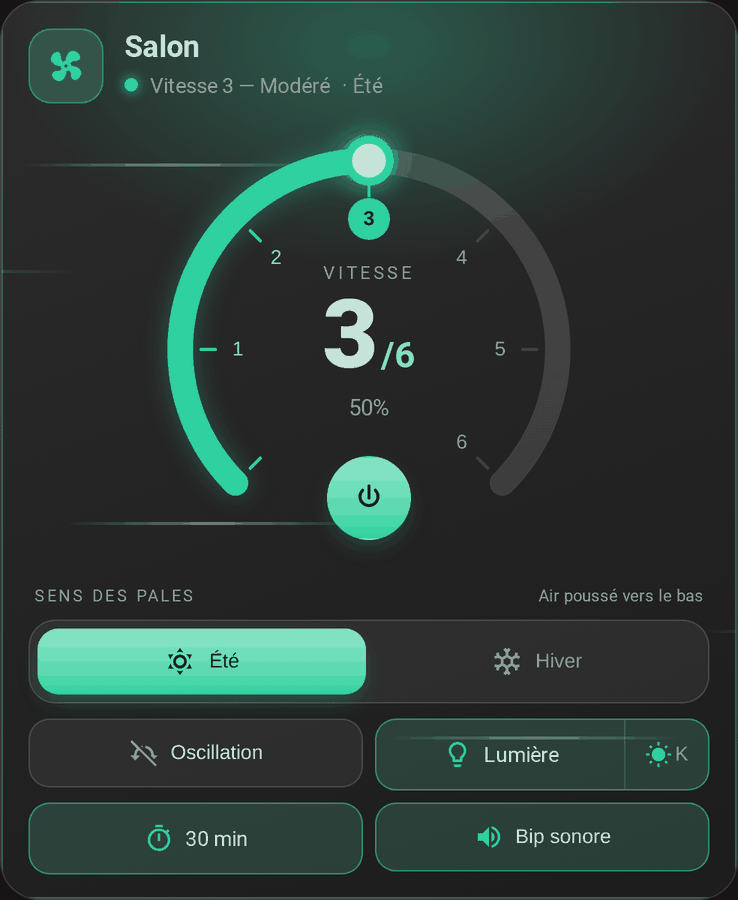

# FanBridge

[English](README.md) · **Français**

Une intégration Home Assistant pour les ventilateurs de plafond connectés. Elle **fusionne une entité locale et une entité cloud du même ventilateur** (par exemple Tuya Local et Tuya) en un seul jeu d'entités, la locale étant prioritaire et la cloud servant de secours, associe les **boutons d'une télécommande** à des actions, et fournit une **carte de tableau de bord** pour tout commander. La carte fonctionne aussi seule, avec n'importe quelle entité `fan`.

  

## Fonctionnalités

| | |
| --- | --- |
| 🔁 **Principal et secours** | Pour le ventilateur, la lumière, la minuterie d'arrêt et le bip, une entité principale sert tant qu'elle est disponible et une entité de secours prend le relais sinon, puis lui rend la main dès son retour. → [Principal et secours](docs/fr/fans.md) |
| 🎚️ **Pourcentages des vitesses** | Deux intégrations s'accordent rarement sur les vitesses d'un ventilateur (6 pas contre 100). Donnez le pourcentage de chaque vitesse pour chacune, et le ventilateur fusionné expose des pas réguliers. → [Pourcentages des vitesses](docs/fr/fans.md#pourcentages-des-vitesses) |
| 🎛️ **Télécommandes** | Associez les boutons d'une télécommande Zigbee2MQTT (topic MQTT, capteur d'action ou entité événement) à 15 actions, au lieu d'écrire des automatisations. → [Télécommandes](docs/fr/remotes.md) |
| 🖥️ **Carte de tableau de bord** | Livrée avec l'intégration, rien à installer : cadran des vitesses, sens été/hiver, préréglage, oscillation, lumière, minuterie et bip, avec un badge quand le secours est en service. → [La carte](docs/fr/card.md) |
| ⚙️ **Réglages dans l'interface** | Un assistant d'ajout et une fenêtre d'options, sans YAML. → [Configuration](docs/fr/configuration.md) |

## Prérequis

- **Home Assistant 2026.2** ou plus récent
- Une entité `fan` (deux pour utiliser un secours)
- En option : l'intégration **MQTT** pour les télécommandes lues sur des topics MQTT (Zigbee2MQTT)

La carte seule fonctionne dès Home Assistant **2024.8**, avec tout navigateur qui gère le `color-mix()` CSS (tous les navigateurs récents et les applications mobiles actuelles).

## Installation

Ou à la main :

1. Ouvrez **HACS** dans Home Assistant, puis le menu à trois points → **Dépôts personnalisés**
2. Ajoutez `https://github.com/Gamso/fan_bridge` avec la catégorie **Intégration**
3. Cherchez **FanBridge**, installez-la, puis redémarrez Home Assistant

La carte arrive avec l'intégration : aucune ressource Lovelace à ajouter.

> **Vous veniez de la carte 1.1.x ?** HACS ne peut pas changer la catégorie d'un dépôt qu'il connaît déjà : supprimez d'abord l'ancien dépôt *Tableau de bord* et l'ancienne ressource `custom-fan-card.js`, puis rajoutez-le comme *Intégration* (le dépôt est maintenant `Gamso/fan_bridge`, l'ancienne adresse redirige). `type: custom:custom-fan-card` dans vos tableaux de bord continue de fonctionner, mais `custom:fan-bridge-card` est le nouveau nom.
>
> **Préversions.** HACS valide la dernière version *stable* à l'ajout d'un dépôt : une préversion seule ne peut donc pas être ajoutée. Activez *Afficher les versions bêta* sur le dépôt une fois ajouté, ou copiez `custom_components/fan_bridge` dans `<config>/custom_components`.

Pour utiliser la carte seule, voir [Sans l'intégration](docs/fr/card.md#sans-lintégration).

## Premiers pas

Ou :

1. **Paramètres → Appareils et services → Ajouter une intégration → FanBridge**
2. Nommez le ventilateur, choisissez l'entité ventilateur et, en option, un ventilateur de secours
3. Ajoutez la carte **FanBridge** à un tableau de bord (ou `type: custom:fan-bridge-card`, `fan_entity: fan.<nom>`)

Ouvrez ensuite **Configurer** pour ajouter la lumière, la minuterie, le bip, les pourcentages des vitesses et les boutons de télécommande, voir [Configuration](docs/fr/configuration.md).

## Documentation

| Page | Contenu |
| --- | --- |
| [Configuration](docs/fr/configuration.md) | Ajouter un ventilateur, la fenêtre d'options et les entités |
| [Principal et secours](docs/fr/fans.md) | Quelle entité est en service, pourcentages des vitesses, entités fusionnées |
| [Télécommandes](docs/fr/remotes.md) | Associer les boutons d'une télécommande à des actions |
| [La carte](docs/fr/card.md) | Ce que montre la carte, ses options, la détection, l'usage sans l'intégration |
| [Entités et services](docs/fr/reference.md) | Toutes les entités, attributs et services, le fichier de la carte |
| [Développement](docs/fr/development.md) | Organisation du dépôt, tests, construction de la carte, devcontainer |

## Historique des versions

Voir [CHANGELOG.md](CHANGELOG.md).

## Licence

[MIT](LICENSE)
