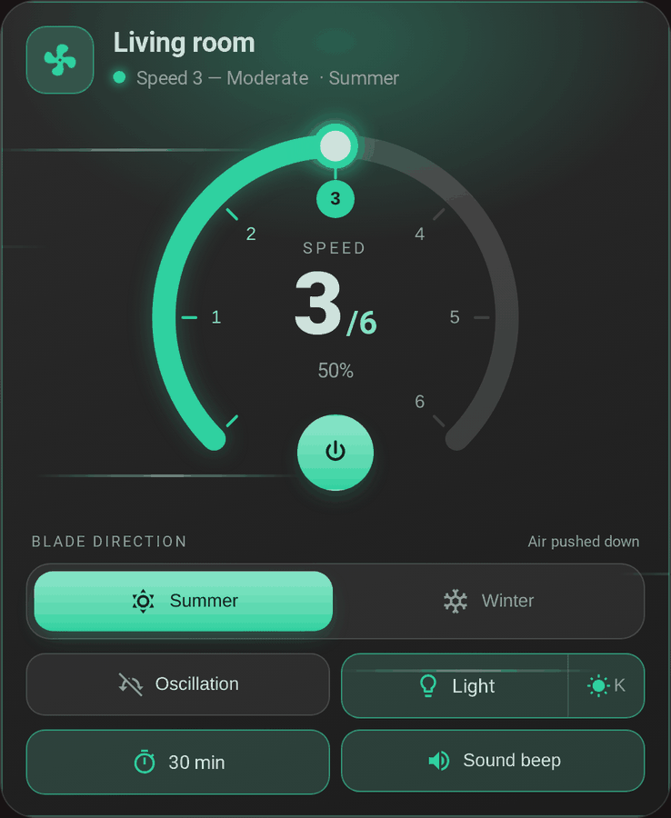
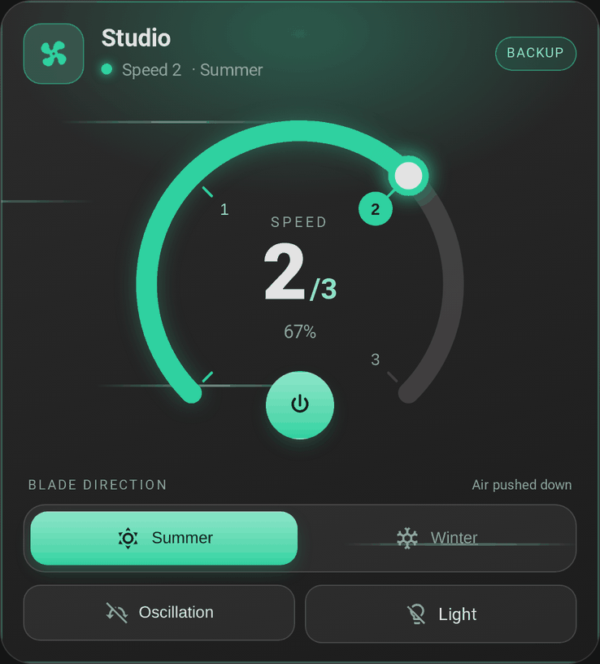
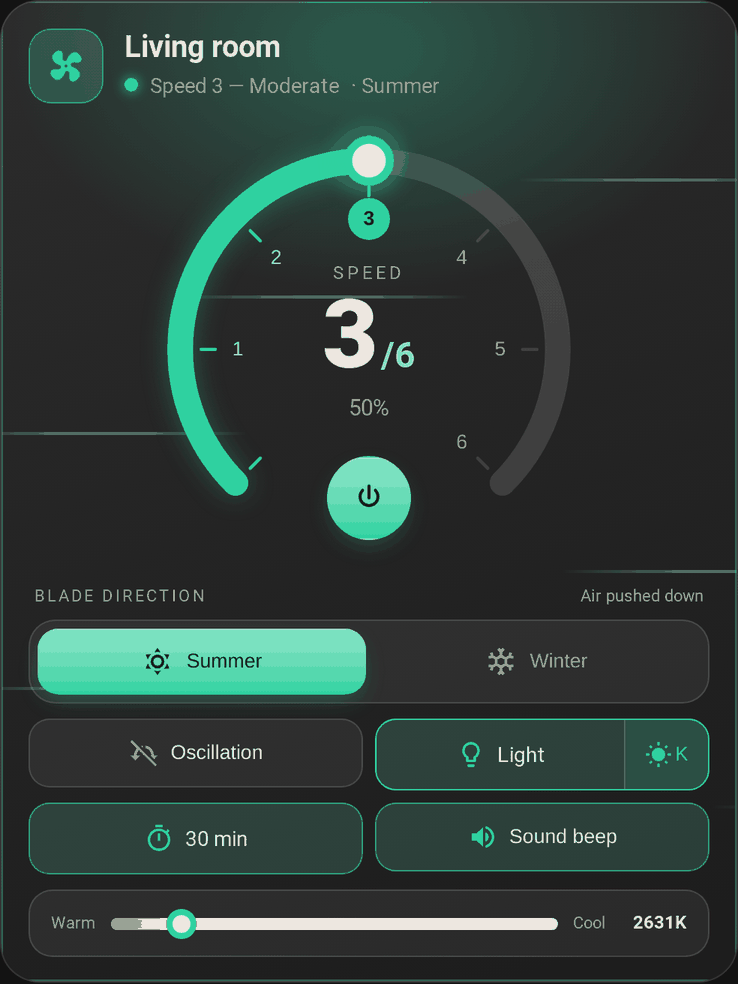

# The card

[← Documentation](../../README.md#documentation) · [Français](../fr/card.md)

A dashboard card to control a ceiling fan, in a dark glass style: a round speed dial, a summer/winter blade direction, and chips for the preset, oscillation, light, stop timer and beep. It ships with the integration and loads by itself: no Lovelace resource to add. It also works **on its own**, with any `fan` entity, see [Without the integration](#without-the-integration).

<p align="center">
  
</p>

## Adding the card

**Edit dashboard → Add card → FanBridge**, or in YAML:

```yaml
type: custom:fan-bridge-card
fan_entity: fan.living_room
```

The light, the timer and the beep are discovered from the name of the fan, so that is enough. Reload the browser page after installing or updating the integration. A new card is not added to a dashboard by itself: add one per fan.

With a fan merged by the integration the visual editor only asks for what belongs to the card (name, direction, light while off): the backup fan, the entities and the speeds are set in the integration, see [Main and backup fans](fans.md).

## What it shows

- **Speed dial**: 270° with one numbered step per speed. Tap the arc or a number to pick a speed. The number of speeds comes from the fan's `percentage_step` (6 when it is not reported); 6-speed fans get named speeds (Gentle, Soft, Moderate, Normal, Strong, Turbo), others "Speed N". A fan with more than 10 steps (continuous speed) gets 6.
- **Power button** in the opening of the dial, shown only if the fan can be turned on and off. An on/off fan without speeds gets no dial.
- **Animated fan icon** that spins faster with speed, and still when the browser asks for reduced motion.
- **Blade direction** (summer / winter) on its own row, independent of power, with a different background effect for each (air streaks / rising particles). It is shown for fans that support `direction`. See [Summer / winter](#summer--winter).
- **Chips** for the preset, oscillation, light, stop timer and beep, each shown only if the fan supports it.
- **Backup badge** while the backup fan is in charge.

  

- Controls that do not apply while the fan is off (light, beep, preset, timer, direction) are disabled. A fan in `unknown` state counts as off and unavailable.
- **Stop timer presets**, always, also for fans whose timer is a free-form `number`.
- **Light colour temperature**, tucked behind a button next to the light chip.

  


Text and surfaces follow the Home Assistant theme, light or dark. The language is detected from Home Assistant (`fr` / `en`).

### Summer / winter

Not every fan spins counter-clockwise for summer. `summer_direction` tells the card which of the fan's two raw directions (`forward` or `reverse`) is summer mode; the card then maps the toggle and calls `fan.set_direction` accordingly.

### Preset mode

If the fan declares `preset_modes`, a preset chip appears. Picking a preset calls `fan.set_preset_mode`; picking a speed hands control back to `fan.set_percentage`. A preset named `normal` (any case) counts as "no active preset": the header shows the speed instead.

### Light

Some kits cut the light together with the fan, so the light chip is disabled while the fan is off. Set `light_independent: true` for a fan whose light works on its own.

## Options

Only `fan_entity` is required.

| Option | Type | Default | Description |
| --- | --- | --- | --- |
| `fan_entity` | string | **required** | The `fan` entity to control. |
| `name` | string | fan friendly name | Card title. |
| `show_name` | boolean | `true` | Show the card title. |
| `summer_direction` | string | `forward` | Which raw direction (`forward` / `reverse`) is summer mode. |
| `light_independent` | boolean | `false` | Keep the light usable while the fan is off. |
| `light_entity` | string | auto-discovered | `light` entity of the fan. |
| `timer_entity` | string | auto-discovered | Stop-timer entity (`number` or `select`). |
| `sound_entity` | string | auto-discovered | `switch` entity of the beep. |

## Theming

Text, surfaces and borders come from the active Home Assistant theme. The accent is green; override it from a theme or with card-mod:

| Variable | Default | Used for |
| --- | --- | --- |
| `--fan-bridge-card-accent` | `#2fd1a0` | Dial, active controls, glow and effects |

## Without the integration

The card works on its own with any `fan` entity, and then does the work of the integration itself, with extra options:

```yaml
type: custom:fan-bridge-card
fan_entity: fan.ceiling_fan_with_light
fallback_fan_entity: fan.ceiling_fan_with_light_cloud # used only while fan_entity is unavailable
speed_percentages: [17, 33, 50, 67, 83, 100] # percentage of each speed of fan_entity
fallback_speed_percentages: [1, 21, 41, 60, 80, 100] # same for fallback_fan_entity
fallback_light_entity: light.ceiling_fan_with_light_cloud
fallback_timer_entity: number.ceiling_fan_with_light_cloud_timer
fallback_sound_entity: switch.ceiling_fan_with_light_cloud_son
```

| Option | Type | Default | Description |
| --- | --- | --- | --- |
| `fallback_fan_entity` | string | none | Second fan (the cloud twin of a local fan), used only while `fan_entity` is `unavailable` / `unknown`. Its light, timer and beep are discovered from its own name, or set with the three `fallback_*` options below; `light_entity`, `timer_entity` and `sound_entity` apply to `fan_entity` only. |
| `speed_percentages` | list | from `percentage_step` | Percentage of each speed, lowest first. The card sends these values and reads the speed as the highest one not above the fan's percentage. Max 10 values, strictly increasing. |
| `fallback_speed_percentages` | list | from `percentage_step` | Same, for `fallback_fan_entity`. |
| `fallback_light_entity` | string | discovered | Light used while the backup fan is in charge. |
| `fallback_timer_entity` | string | discovered | Timer used while the backup fan is in charge. |
| `fallback_sound_entity` | string | discovered | Beep switch used while the backup fan is in charge. |

Prefer the integration when you can: it also serves automations, scripts and voice assistants, which the card alone cannot.

### Manual installation

1. Download `dist/fan-bridge-card.js` from this repository.
2. Copy it to `<config>/www/fan-bridge-card.js` (create the `www` folder if needed, then restart Home Assistant once so `/local/` is served).
3. **Settings → Dashboards → ⋮ → Resources → Add resource**, enter `/local/fan-bridge-card.js?v=1.2.0` and choose **JavaScript module**. Change the `?v=` value after each update to bypass the browser cache.
4. Refresh the browser: the console prints `FAN-BRIDGE-CARD v1.2.0`. Check that it is the version you installed.

## Auto-discovery

From `fan.ceiling_fan_with_light` the card extracts the base id `ceiling_fan_with_light` and, for each role, looks for:

1. an entity named exactly like the fan (`light.ceiling_fan_with_light`; light and timer only, because a switch named like the fan is its power switch);
2. otherwise, among the entities named `<base>_…`, the one with a known suffix: `light` / `lumiere` / `lamp` for the light, `timer` / `minuteur` / `countdown` for the timer, `sound` / `son` / `beep` / `bip` / `buzzer` for the beep;
3. otherwise the only remaining `<base>_…` entity of the domain, unless its suffix names another feature (`oscillation`, `swing`, `child_lock`, ...) or another role.

Entities of another fan whose name extends this one are ignored: with `fan.ceiling_fan` and `fan.ceiling_fan_2`, the first card never picks `light.ceiling_fan_2_light`. When several entities match equally well, the card picks none and the editor lists the candidates: choose one there, or with `light_entity`, `timer_entity` or `sound_entity`. Controls for entities that are not found are hidden.

The timer is looked up in the `number` domain first, then in `select`. The card calls `number.set_value` or `select.select_option` according to the domain, and shows the options a `select` reports.

## Speed mapping

The number of speeds is `100 / percentage_step`. A 6-speed fan gets named speeds:

| Speed | Percentage | EN label | FR label |
| --- | --- | --- | --- |
| Off | 0 % | Off | Arrêt |
| 1 | 17 % | Gentle | Très doux |
| 2 | 33 % | Soft | Doux |
| 3 | 50 % | Moderate | Modéré |
| 4 | 67 % | Normal | Moyen |
| 5 | 83 % | Strong | Fort |
| 6 | 100 % | Turbo | Turbo |

Other speed counts get numbered labels. Clicking speed *n* sends `floor(n × 100 / speeds)` % to `fan.set_percentage` (16, 33, 50, 66, 83, 100 on 6 speeds), the value the Home Assistant UI sends: it is the upper bound of speed *n* whether the integration rounds, rounds up or uses Home Assistant's ordered speed lists.
