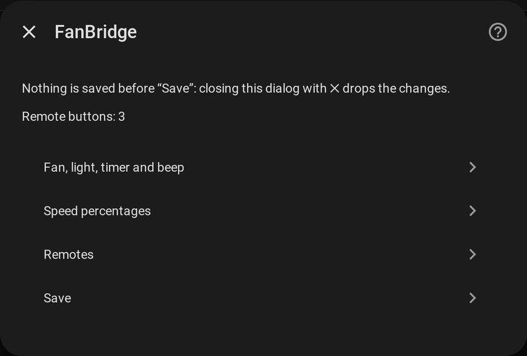
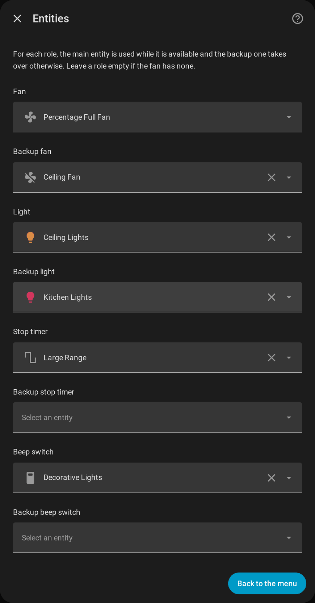

# Configuration

[← Documentation](../../README.md#documentation) · [Français](../fr/configuration.md)

## Adding a fan

**Settings → Devices & Services → Add Integration → FanBridge**, then:

| Field | Meaning |
| --- | --- |
| **Name** | Names the device and the entities (`fan.<name>`, `light.<name>_light`, ...) |
| **Fan** | The fan used as long as it is available, typically the local integration (Tuya Local, ...) |
| **Backup fan** (optional) | Takes over while the main fan is unavailable, typically the cloud integration (Tuya, ...) |

Each fan is its own entry: add the integration once per fan. The backup fan must be a different entity from the main one.

## The options dialog

Everything else is set from **Settings → Devices & Services → FanBridge → Configure**, and can be changed at any time.

**Nothing is stored until Save**: closing the dialog with ✕ drops the changes. Saving reloads the fan, so the new settings apply at once.

| Menu entry | What it sets | Documented in |
| --- | --- | --- |
| **Fan, light, timer and beep** | A main and a backup entity for each role | [Entities](#entities) below |
| **Speed percentages** | The percentage of each speed, for the main and the backup fan | [Main and backup fans → Speed percentages](fans.md#speed-percentages) |
| **Remotes** | The buttons of a remote mapped to actions | [Remotes](remotes.md) |

## Entities

For each **role** (fan, light, stop timer, beep switch) you pick a **main** entity and, optionally, a **backup** one. The main entity is used while it is available and the backup one takes over otherwise, see [Main and backup fans](fans.md). A role left empty is simply not created: a fan without a light gets no light entity.

| Role | Domains accepted | Becomes |
| --- | --- | --- |
| Fan | `fan` | `fan.<name>` |
| Light | `light` | `light.<name>_light` |
| Stop timer | `number`, `select` | `select.<name>_timer` |
| Beep switch | `switch` | `switch.<name>_sound` |

## The card

The card needs no setup beyond picking `fan.<name>`: it finds the light, the timer and the beep by itself, and the integration registers it in every dashboard. See [The card](card.md).
