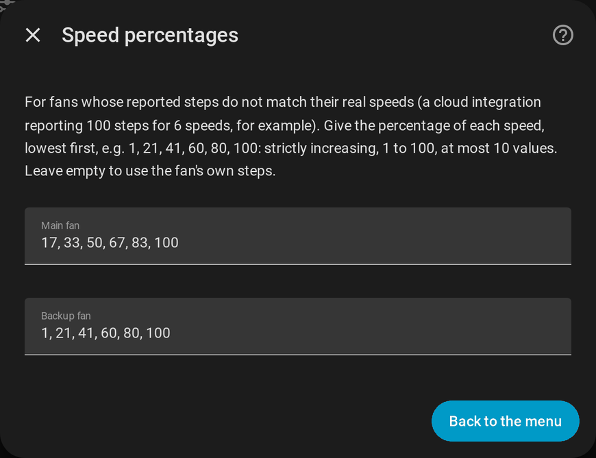

# Main and backup fans

[← Documentation](../../README.md#documentation) · [Français](../fr/fans.md)

A fan often exists twice in Home Assistant, once per integration: a **local** one (Tuya Local, fast, works without internet) and a **cloud** one (Tuya, always reachable but slower, sometimes down). FanBridge merges them into **one set of entities** that automations, scripts, voice assistants and the card can target, whatever integration is working at the time.

## Which entity is in charge

For each role, independently:

1. the **main** entity is used while its state is not `unavailable` or `unknown`;
2. otherwise the **backup** entity is used, if there is one and it is available;
3. otherwise the main entity again (so the merged entity reads as unavailable like it).

The main entity takes back control **as soon as it is available again**: there is no delay and nothing to reset. Roles are independent: the fan can run on its backup while the light still uses its main entity.

The merged entities tell which one is in charge:

| Attribute | Value |
| --- | --- |
| `source_entity` | The entity currently in charge |
| `using_backup` | `true` while the backup entity is in charge |

Commands go to the entity in charge. The fan's own state (speed, direction, presets, oscillation) is read from it, and the merged entity exposes what that fan supports.

## Speed percentages

Two integrations seldom agree on the speeds of the same fan. A local integration reports 6 steps of 16.67 % while the cloud one reports 100 steps, or accepts 1 / 21 / 41 / 60 / 80 / 100 for speeds 1 to 6. Without help, a speed sent through one integration is read as another one through the other.

**Configure → Speed percentages** lets you give, for the main and for the backup fan, the percentage of each speed, lowest first:

```
1, 21, 41, 60, 80, 100
```



- strictly increasing whole numbers from 1 to 100, at most 10 values, separated by commas;
- left empty, the fan's own `percentage_step` is used (6 speeds when it does not report one);
- an invalid list is refused with an error and nothing is saved.

The merged fan **always exposes even steps**, whatever the fan in charge. Setting speed *n* sends the value of the table of the fan in charge (without a table: `floor(n × 100 / speeds)`, the value the Home Assistant UI sends), and reading a percentage gives the highest speed whose value is not above it.

## The merged entities

| Entity | Behaviour |
| --- | --- |
| `fan.<name>` | Speed (even percentages), direction, presets and oscillation of the fan in charge. |
| `light.<name>_light` | On/off, brightness and colour temperature of the light in charge. |
| `select.<name>_timer` | The stop timer as presets (off, 15 min, 30 min, 1 h, 2 h, 4 h, 8 h) for a `number` entity; its own options for a `select`. A `number` set outside the presets (45 min, for instance) is shown as is. |
| `switch.<name>_sound` | The beep switch in charge. |

Entity ids do not depend on the language of your Home Assistant. See [Entities and services](reference.md) for the full list.
