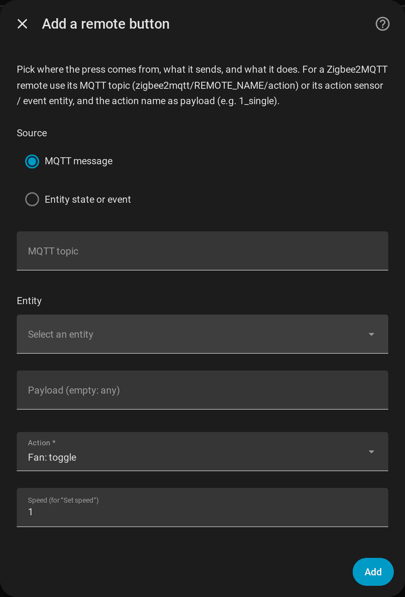
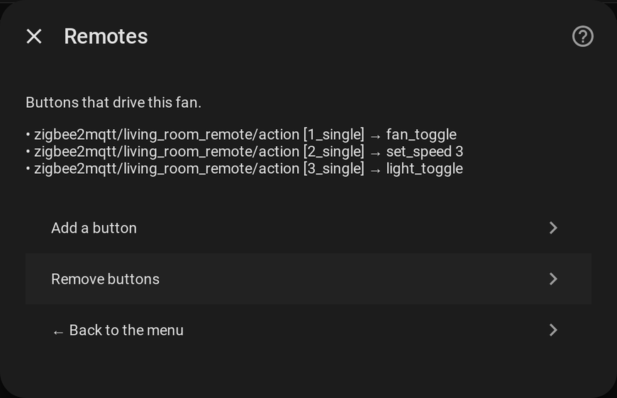

# Remotes

[← Documentation](../../README.md#documentation) · [Français](../fr/remotes.md)

A remote button is mapped to an action of the fan in the integration itself: no automation to write. It replaces automations such as "button 4 → set the percentage from a template".

## Adding a button

**Configure → Remotes → Add a button**.

Each button maps **a source** to **an action**.

### Source

| Source | Fields | Fires when |
| --- | --- | --- |
| **MQTT message** | **MQTT topic**, **Payload** | A message is published on the topic with that payload. For Zigbee2MQTT: `zigbee2mqtt/<remote name>/action` and the action name (`1_single`, `2_double`, ...). |
| **Entity state or event** | **Entity**, **Payload** | The state of the entity becomes the payload (a Zigbee2MQTT *action* sensor), or an `event` entity fires an event of that type. Accepted domains: `event`, `sensor`, `binary_sensor`, `input_text`, `select`. |

An **empty payload matches any press** of that source. A topic is required for an MQTT button and an entity for an entity button, the dialog says so otherwise. The MQTT source needs the MQTT integration.

### Action

| Action | Does |
| --- | --- |
| Fan: toggle / turn on / turn off | Switches the fan |
| Fan: one speed up / one speed down | Moves one speed (down from the lowest speed turns the fan off, like Home Assistant) |
| Fan: set a speed | Sets the speed given in **Speed** (1 to 10) |
| Light: toggle / turn on / turn off | Switches the light |
| Direction: toggle / forward / reverse | Sets the blade direction |
| Oscillation: toggle | Toggles oscillation |
| Preset: next | Goes to the next preset, then back to the first |
| Beep: toggle | Toggles the beep switch |

Actions go through the merged entities, so the **backup fan, the speed percentages and the availability rules apply to a remote** like they do to the card.

## The list

The page lists every button as `source [payload] → action`. **Remove buttons** deletes the ones you tick. As everywhere in the dialog, nothing is stored until you **Save** from the menu.
