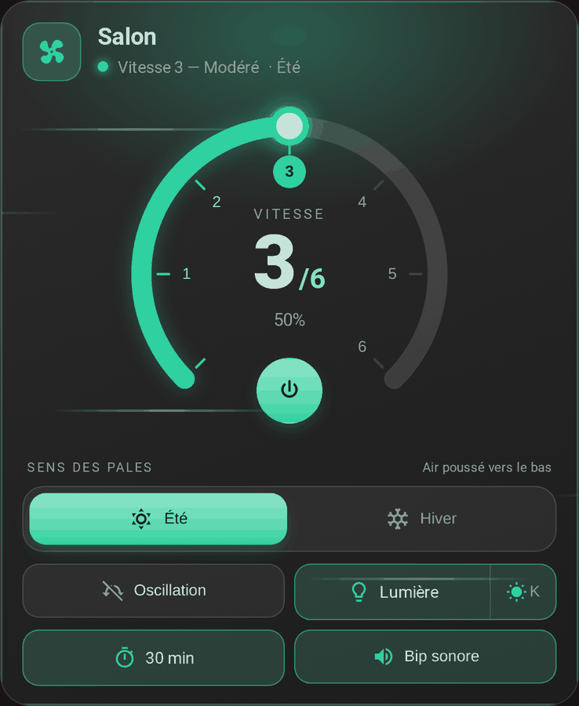
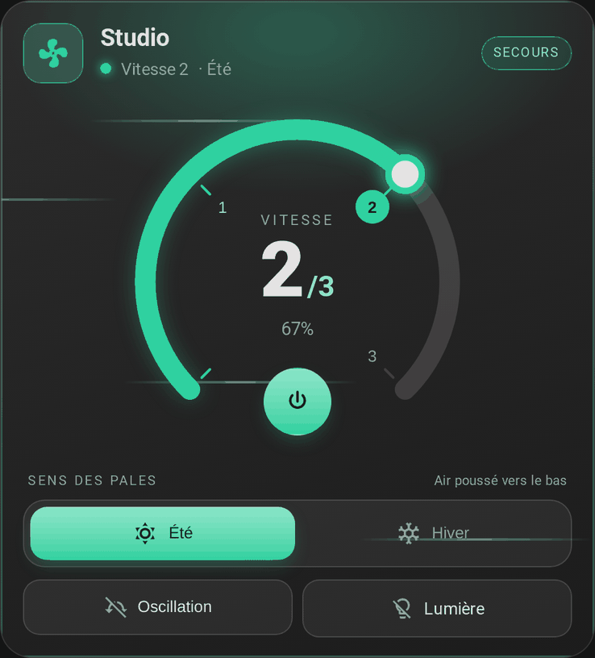
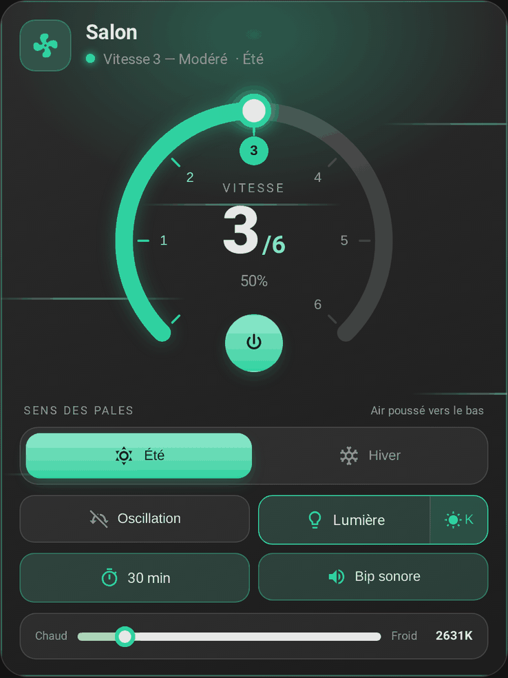

# La carte

[← Documentation](../../README.fr.md#documentation) · [English](../en/card.md)

Une carte de tableau de bord pour commander un ventilateur de plafond, dans un style verre sombre : un cadran rond des vitesses, un sens des pales été/hiver, et des pastilles pour le préréglage, l'oscillation, la lumière, la minuterie d'arrêt et le bip. Elle est livrée avec l'intégration et se charge seule : aucune ressource Lovelace à ajouter. Elle fonctionne aussi **seule**, avec n'importe quelle entité `fan`, voir [Sans l'intégration](#sans-lintégration).

<p align="center">
  
</p>

## Ajouter la carte

**Modifier le tableau de bord → Ajouter une carte → FanBridge**, ou en YAML :

```yaml
type: custom:fan-bridge-card
fan_entity: fan.salon
```

La lumière, la minuterie et le bip sont détectés à partir du nom du ventilateur, cette ligne suffit donc. Rechargez la page du navigateur après l'installation ou la mise à jour de l'intégration. Une nouvelle carte n'est pas ajoutée seule à un tableau de bord : ajoutez-en une par ventilateur.

Avec un ventilateur fusionné par l'intégration, l'éditeur visuel ne demande que ce qui relève de la carte (nom, sens, lumière éteinte) : le secours, les entités et les vitesses se règlent dans l'intégration, voir [Principal et secours](fans.md).

## Ce qu'elle affiche

- **Cadran des vitesses** : 270° avec un pas numéroté par vitesse. Touchez l'arc ou un numéro pour choisir une vitesse. Le nombre de vitesses vient du `percentage_step` du ventilateur (6 s'il n'est pas annoncé) ; les ventilateurs à 6 vitesses ont des vitesses nommées (Très doux, Doux, Modéré, Moyen, Fort, Turbo), les autres « Vitesse N ». Un ventilateur de plus de 10 pas (vitesse continue) en a 6.
- **Bouton marche/arrêt** dans l'ouverture du cadran, affiché seulement si le ventilateur peut être allumé et éteint. Un ventilateur tout ou rien sans vitesses n'a pas de cadran.
- **Icône de ventilateur animée** qui tourne plus vite avec la vitesse, et immobile quand le navigateur demande de réduire les animations.
- **Sens des pales** (été / hiver) sur sa propre ligne, indépendant de la marche, avec un effet de fond différent pour chacun (filets d'air / particules qui montent). Il apparaît pour les ventilateurs qui gèrent `direction`. Voir [Été / hiver](#été--hiver).
- **Pastilles** pour le préréglage, l'oscillation, la lumière, la minuterie d'arrêt et le bip, chacune affichée seulement si le ventilateur la gère.
- **Badge de secours** tant que le ventilateur de secours est en service.

  

- Les commandes qui n'ont pas de sens ventilateur éteint (lumière, bip, préréglage, minuterie, sens) sont désactivées. Un ventilateur à l'état `unknown` compte comme éteint et indisponible.
- **Préréglages de minuterie**, toujours, y compris pour les ventilateurs dont la minuterie est un `number` en saisie libre.
- **Température de couleur de la lumière**, derrière un bouton à côté de la pastille lumière.

  


Le texte et les surfaces suivent le thème de Home Assistant, clair ou sombre. La langue est détectée depuis Home Assistant (`fr` / `en`).

### Été / hiver

Tous les ventilateurs ne tournent pas à gauche en été. `summer_direction` indique à la carte laquelle des deux directions brutes du ventilateur (`forward` ou `reverse`) correspond à l'été ; la carte associe alors la bascule et appelle `fan.set_direction` en conséquence.

### Préréglage

Si le ventilateur déclare des `preset_modes`, une pastille de préréglage apparaît. Choisir un préréglage appelle `fan.set_preset_mode` ; choisir une vitesse rend la main à `fan.set_percentage`. Un préréglage nommé `normal` (quelle que soit la casse) compte comme « aucun préréglage actif » : l'en-tête affiche alors la vitesse.

### Lumière

Certains kits coupent la lumière avec le ventilateur : la pastille lumière est alors désactivée ventilateur éteint. Mettez `light_independent: true` pour un ventilateur dont la lumière fonctionne seule.

## Options

Seul `fan_entity` est obligatoire.

| Option | Type | Défaut | Description |
| --- | --- | --- | --- |
| `fan_entity` | texte | **obligatoire** | L'entité `fan` à commander. |
| `name` | texte | nom du ventilateur | Titre de la carte. |
| `show_name` | booléen | `true` | Afficher le titre de la carte. |
| `summer_direction` | texte | `forward` | Direction brute (`forward` / `reverse`) qui correspond à l'été. |
| `light_independent` | booléen | `false` | Garder la lumière utilisable ventilateur éteint. |
| `light_entity` | texte | détectée | Entité `light` du ventilateur. |
| `timer_entity` | texte | détectée | Entité de minuterie d'arrêt (`number` ou `select`). |
| `sound_entity` | texte | détectée | Entité `switch` du bip. |

## Thème

Le texte, les surfaces et les bordures viennent du thème actif de Home Assistant. L'accent est vert ; changez-le depuis un thème ou avec card-mod :

| Variable | Défaut | Sert à |
| --- | --- | --- |
| `--fan-bridge-card-accent` | `#2fd1a0` | Cadran, commandes actives, halo et effets |

## Sans l'intégration

La carte fonctionne seule avec n'importe quelle entité `fan`, et fait alors elle-même le travail de l'intégration, avec des options en plus :

```yaml
type: custom:fan-bridge-card
fan_entity: fan.ceiling_fan_with_light
fallback_fan_entity: fan.ceiling_fan_with_light_cloud # utilisé seulement quand fan_entity est indisponible
speed_percentages: [17, 33, 50, 67, 83, 100] # pourcentage de chaque vitesse de fan_entity
fallback_speed_percentages: [1, 21, 41, 60, 80, 100] # idem pour fallback_fan_entity
fallback_light_entity: light.ceiling_fan_with_light_cloud
fallback_timer_entity: number.ceiling_fan_with_light_cloud_timer
fallback_sound_entity: switch.ceiling_fan_with_light_cloud_son
```

| Option | Type | Défaut | Description |
| --- | --- | --- | --- |
| `fallback_fan_entity` | texte | aucun | Second ventilateur (le jumeau cloud d'un ventilateur local), utilisé seulement quand `fan_entity` est `unavailable` / `unknown`. Sa lumière, sa minuterie et son bip sont détectés d'après son propre nom, ou réglés avec les trois options `fallback_*` ci-dessous ; `light_entity`, `timer_entity` et `sound_entity` ne valent que pour `fan_entity`. |
| `speed_percentages` | liste | d'après `percentage_step` | Pourcentage de chaque vitesse, de la plus basse à la plus haute. La carte envoie ces valeurs et lit la vitesse comme la plus haute qui n'est pas au-dessus du pourcentage du ventilateur. 10 valeurs au plus, strictement croissantes. |
| `fallback_speed_percentages` | liste | d'après `percentage_step` | Idem, pour `fallback_fan_entity`. |
| `fallback_light_entity` | texte | détectée | Lumière utilisée quand le ventilateur de secours est en service. |
| `fallback_timer_entity` | texte | détectée | Minuterie utilisée quand le ventilateur de secours est en service. |
| `fallback_sound_entity` | texte | détectée | Interrupteur du bip utilisé quand le ventilateur de secours est en service. |

Préférez l'intégration quand c'est possible : elle sert aussi aux automatisations, aux scripts et aux assistants vocaux, ce que la carte seule ne sait pas faire.

### Installation manuelle

1. Téléchargez `dist/fan-bridge-card.js` depuis ce dépôt.
2. Copiez-le dans `<config>/www/fan-bridge-card.js` (créez le dossier `www` au besoin, puis redémarrez Home Assistant une fois pour que `/local/` soit servi).
3. **Paramètres → Tableaux de bord → ⋮ → Ressources → Ajouter une ressource**, saisissez `/local/fan-bridge-card.js?v=1.2.0` et choisissez **Module JavaScript**. Changez la valeur de `?v=` à chaque mise à jour pour contourner le cache du navigateur.
4. Actualisez le navigateur : la console affiche `FAN-BRIDGE-CARD v1.2.0`. Vérifiez que c'est la version installée.

## Détection automatique

À partir de `fan.ceiling_fan_with_light`, la carte extrait l'identifiant de base `ceiling_fan_with_light` et cherche, pour chaque rôle :

1. une entité qui porte exactement le nom du ventilateur (`light.ceiling_fan_with_light` ; lumière et minuterie seulement, car un interrupteur du même nom est l'interrupteur marche/arrêt) ;
2. sinon, parmi les entités nommées `<base>_…`, celle dont le suffixe est connu : `light` / `lumiere` / `lamp` pour la lumière, `timer` / `minuteur` / `countdown` pour la minuterie, `sound` / `son` / `beep` / `bip` / `buzzer` pour le bip ;
3. sinon la seule entité restante `<base>_…` du domaine, sauf si son suffixe désigne une autre fonction (`oscillation`, `swing`, `child_lock`, ...) ou un autre rôle.

Les entités d'un autre ventilateur dont le nom prolonge celui-ci sont ignorées : avec `fan.ceiling_fan` et `fan.ceiling_fan_2`, la première carte ne prend jamais `light.ceiling_fan_2_light`. Quand plusieurs entités conviennent aussi bien, la carte n'en choisit aucune et l'éditeur liste les candidates : choisissez-en une là, ou avec `light_entity`, `timer_entity` ou `sound_entity`. Les commandes dont l'entité n'est pas trouvée sont masquées.

La minuterie est cherchée d'abord dans le domaine `number`, puis dans `select`. La carte appelle `number.set_value` ou `select.select_option` selon le domaine, et affiche les options qu'un `select` annonce.

## Correspondance des vitesses

Le nombre de vitesses vaut `100 / percentage_step`. Un ventilateur à 6 vitesses a des vitesses nommées :

| Vitesse | Pourcentage | Libellé FR | Libellé EN |
| --- | --- | --- | --- |
| Arrêt | 0 % | Arrêt | Off |
| 1 | 17 % | Très doux | Gentle |
| 2 | 33 % | Doux | Soft |
| 3 | 50 % | Modéré | Moderate |
| 4 | 67 % | Moyen | Normal |
| 5 | 83 % | Fort | Strong |
| 6 | 100 % | Turbo | Turbo |

Les autres nombres de vitesses ont des libellés numérotés. Cliquer sur la vitesse *n* envoie `floor(n × 100 / vitesses)` % à `fan.set_percentage` (16, 33, 50, 66, 83, 100 sur 6 vitesses), la valeur qu'envoie l'interface de Home Assistant : c'est la borne haute de la vitesse *n*, que l'intégration arrondisse, arrondisse au-dessus ou utilise les listes de vitesses ordonnées de Home Assistant.
