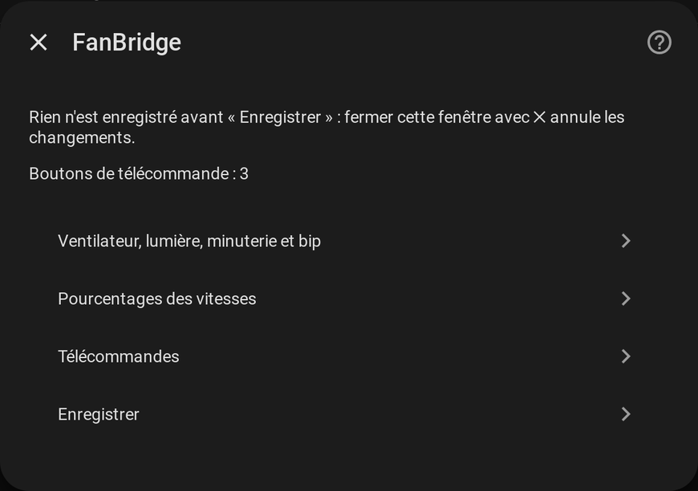
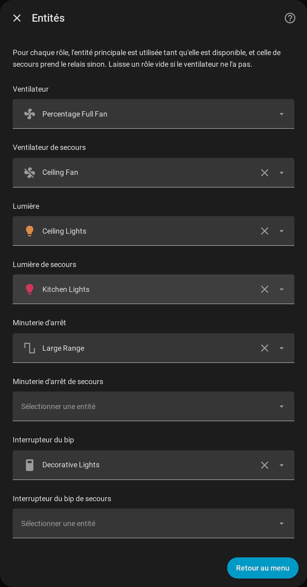

# Configuration

[← Documentation](../../README.fr.md#documentation) · [English](../en/configuration.md)

## Ajouter un ventilateur

**Paramètres → Appareils et services → Ajouter une intégration → FanBridge**, puis :

| Champ | Signification |
| --- | --- |
| **Nom** | Nomme l'appareil et les entités (`fan.<nom>`, `light.<nom>_light`, ...) |
| **Ventilateur** | Le ventilateur utilisé tant qu'il est disponible, en général l'intégration locale (Tuya Local, ...) |
| **Ventilateur de secours** (facultatif) | Prend le relais quand le principal est indisponible, en général l'intégration cloud (Tuya, ...) |

Chaque ventilateur est une entrée à part : ajoutez l'intégration une fois par ventilateur. Le ventilateur de secours doit être une autre entité que le principal.

## La fenêtre d'options

Tout le reste se règle dans **Paramètres → Appareils et services → FanBridge → Configurer**, et peut être modifié à tout moment.

**Rien n'est enregistré avant « Enregistrer »** : fermer la fenêtre avec ✕ annule les changements. L'enregistrement recharge le ventilateur, les nouveaux réglages s'appliquent donc aussitôt.

| Entrée du menu | Ce qu'elle règle | Documenté dans |
| --- | --- | --- |
| **Ventilateur, lumière, minuterie et bip** | Une entité principale et une de secours pour chaque rôle | [Entités](#entités) ci-dessous |
| **Pourcentages des vitesses** | Le pourcentage de chaque vitesse, pour le ventilateur principal et celui de secours | [Principal et secours → Pourcentages des vitesses](fans.md#pourcentages-des-vitesses) |
| **Télécommandes** | Les boutons d'une télécommande associés à des actions | [Télécommandes](remotes.md) |

## Entités

Pour chaque **rôle** (ventilateur, lumière, minuterie d'arrêt, bip) vous choisissez une entité **principale** et, en option, une entité **de secours**. L'entité principale sert tant qu'elle est disponible et celle de secours prend le relais sinon, voir [Principal et secours](fans.md). Un rôle laissé vide n'est tout simplement pas créé : un ventilateur sans lumière n'a pas d'entité lumière.

| Rôle | Domaines acceptés | Devient |
| --- | --- | --- |
| Ventilateur | `fan` | `fan.<nom>` |
| Lumière | `light` | `light.<nom>_light` |
| Minuterie d'arrêt | `number`, `select` | `select.<nom>_timer` |
| Interrupteur du bip | `switch` | `switch.<nom>_sound` |

## La carte

La carte n'a rien à régler de plus que `fan.<nom>` : elle trouve seule la lumière, la minuterie et le bip, et l'intégration l'enregistre dans tous les tableaux de bord. Voir [La carte](card.md).
