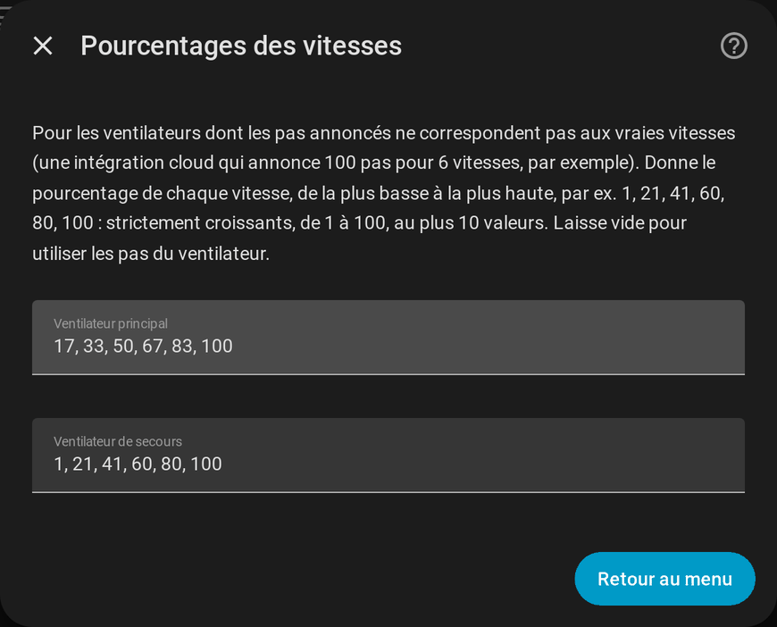

# Principal et secours

[← Documentation](../../README.fr.md#documentation) · [English](../en/fans.md)

Un ventilateur existe souvent en double dans Home Assistant, une fois par intégration : une **locale** (Tuya Local, rapide, fonctionne sans internet) et une **cloud** (Tuya, toujours joignable mais plus lente, parfois en panne). FanBridge les fusionne en **un seul jeu d'entités** que les automatisations, les scripts, les assistants vocaux et la carte peuvent viser, quelle que soit l'intégration qui fonctionne à ce moment-là.

## Quelle entité est en service

Pour chaque rôle, indépendamment :

1. l'entité **principale** sert tant que son état n'est ni `unavailable` ni `unknown` ;
2. sinon l'entité **de secours** sert, s'il y en a une et qu'elle est disponible ;
3. sinon l'entité principale à nouveau (l'entité fusionnée apparaît donc indisponible comme elle).

L'entité principale reprend la main **dès qu'elle est de nouveau disponible** : aucun délai, rien à réinitialiser. Les rôles sont indépendants : le ventilateur peut tourner sur son secours pendant que la lumière utilise encore son entité principale.

Les entités fusionnées indiquent laquelle est en service :

| Attribut | Valeur |
| --- | --- |
| `source_entity` | L'entité actuellement en service |
| `using_backup` | `true` tant que l'entité de secours est en service |

Les commandes vont à l'entité en service. L'état du ventilateur (vitesse, sens, préréglages, oscillation) est lu sur elle, et l'entité fusionnée expose ce que ce ventilateur sait faire.

## Pourcentages des vitesses

Deux intégrations s'accordent rarement sur les vitesses d'un même ventilateur. Une intégration locale annonce 6 pas de 16,67 % quand la cloud annonce 100 pas, ou accepte 1 / 21 / 41 / 60 / 80 / 100 pour les vitesses 1 à 6. Sans aide, une vitesse envoyée par l'une est lue comme une autre par l'autre.

**Configurer → Pourcentages des vitesses** permet de donner, pour le ventilateur principal et pour celui de secours, le pourcentage de chaque vitesse, de la plus basse à la plus haute :

```
1, 21, 41, 60, 80, 100
```



- des entiers strictement croissants de 1 à 100, au plus 10 valeurs, séparés par des virgules ;
- laissé vide, le `percentage_step` du ventilateur est utilisé (6 vitesses s'il n'en annonce pas) ;
- une liste invalide est refusée avec une erreur et rien n'est enregistré.

Le ventilateur fusionné **expose toujours des pas réguliers**, quel que soit le ventilateur en service. Régler la vitesse *n* envoie la valeur du tableau du ventilateur en service (sans tableau : `floor(n × 100 / vitesses)`, la valeur qu'envoie l'interface de Home Assistant), et lire un pourcentage donne la plus haute vitesse dont la valeur n'est pas au-dessus.

## Les entités fusionnées

| Entité | Comportement |
| --- | --- |
| `fan.<nom>` | Vitesse (pourcentages réguliers), sens, préréglages et oscillation du ventilateur en service. |
| `light.<nom>_light` | Allumage, luminosité et température de couleur de la lumière en service. |
| `select.<nom>_timer` | La minuterie d'arrêt sous forme de préréglages (arrêt, 15 min, 30 min, 1 h, 2 h, 4 h, 8 h) pour une entité `number` ; ses propres options pour un `select`. Un `number` réglé hors des préréglages (45 min, par exemple) s'affiche tel quel. |
| `switch.<nom>_sound` | L'interrupteur du bip en service. |

Les identifiants d'entités ne dépendent pas de la langue de Home Assistant. Voir [Entités et services](reference.md) pour la liste complète.
