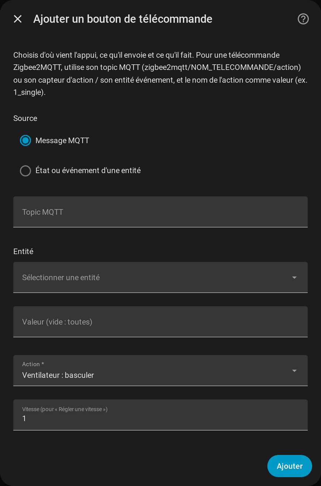
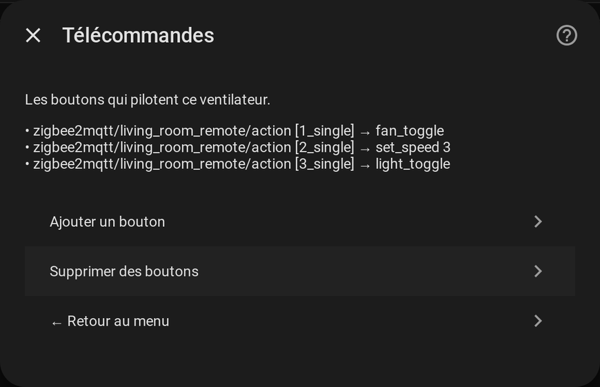

# Télécommandes

[← Documentation](../../README.fr.md#documentation) · [English](../en/remotes.md)

Un bouton de télécommande est associé à une action du ventilateur dans l'intégration elle-même : aucune automatisation à écrire. Cela remplace des automatisations du genre « bouton 4 → régler le pourcentage avec un template ».

## Ajouter un bouton

**Configurer → Télécommandes → Ajouter un bouton**.

Chaque bouton associe **une source** à **une action**.

### Source

| Source | Champs | Se déclenche quand |
| --- | --- | --- |
| **Message MQTT** | **Topic MQTT**, **Valeur** | Un message est publié sur le topic avec cette valeur. Pour Zigbee2MQTT : `zigbee2mqtt/<nom de la télécommande>/action` et le nom de l'action (`1_single`, `2_double`, ...). |
| **État ou événement d'une entité** | **Entité**, **Valeur** | L'état de l'entité devient la valeur (un capteur *action* de Zigbee2MQTT), ou une entité `event` émet un événement de ce type. Domaines acceptés : `event`, `sensor`, `binary_sensor`, `input_text`, `select`. |

Une **valeur vide correspond à tous les appuis** de cette source. Un topic est requis pour un bouton MQTT et une entité pour un bouton d'entité, la fenêtre l'indique sinon. La source MQTT demande l'intégration MQTT.

### Action

| Action | Fait |
| --- | --- |
| Ventilateur : basculer / allumer / éteindre | Commande le ventilateur |
| Ventilateur : une vitesse de plus / de moins | Change d'une vitesse (descendre depuis la plus basse éteint le ventilateur, comme Home Assistant) |
| Ventilateur : régler une vitesse | Règle la vitesse donnée dans **Vitesse** (1 à 10) |
| Lumière : basculer / allumer / éteindre | Commande la lumière |
| Sens : basculer / normal / inverse | Règle le sens des pales |
| Oscillation : basculer | Bascule l'oscillation |
| Préréglage : suivant | Passe au préréglage suivant, puis revient au premier |
| Bip : basculer | Bascule l'interrupteur du bip |

Les actions passent par les entités fusionnées : **le ventilateur de secours, les pourcentages des vitesses et les règles de disponibilité s'appliquent donc à une télécommande** comme à la carte.

## La liste

La page liste chaque bouton sous la forme `source [valeur] → action`. **Supprimer des boutons** retire ceux que vous cochez. Comme partout dans la fenêtre, rien n'est enregistré avant **Enregistrer** dans le menu.
